# Nomi — The Complete Project Document

*Everything about this project in one place: what it is, how every piece works, and how to present it on a resume and in interviews.*

**Author:** Ayush Kumar · [LinkedIn](https://www.linkedin.com/in/ayushkumar277) · [GitHub](https://github.com/Ayush277)
**Status:** Beta, in active development · ~12,700 lines of TypeScript/TSX · 247 unit/integration tests across 34 files · v0.21.x

---

## 1. What Nomi is (the one-liner)

> **Nomi is an on-device AI companion that lives beside your browser — it observes your day, understands it, remembers it, and answers from that memory. It never clicks, never types, never takes control, and nothing leaves your machine by default.**

It's a Chrome extension (Manifest V3) with a living animated orb on every page. It tracks how you spend time, encrypts everything locally, builds a knowledge base from your own documents and days, and answers questions through a retrieval-augmented reasoning agent — by text or voice.

---

## What Nomi looks like

| | |
|---|---|
| 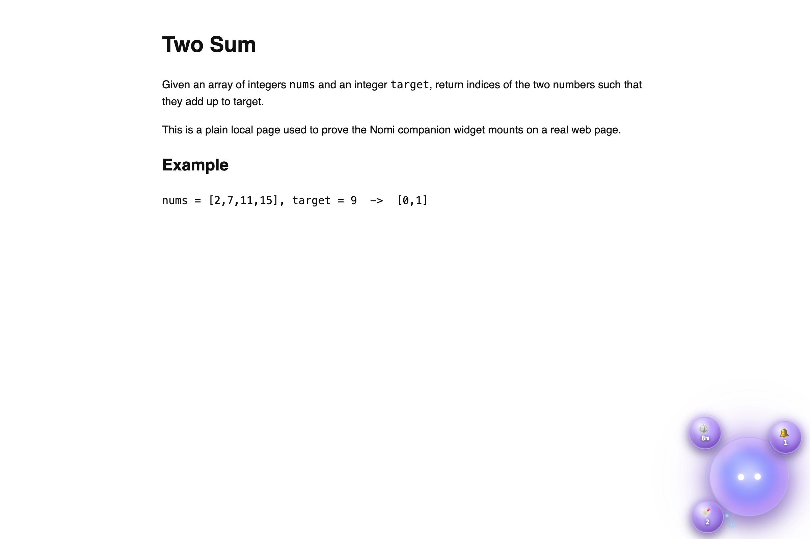 | 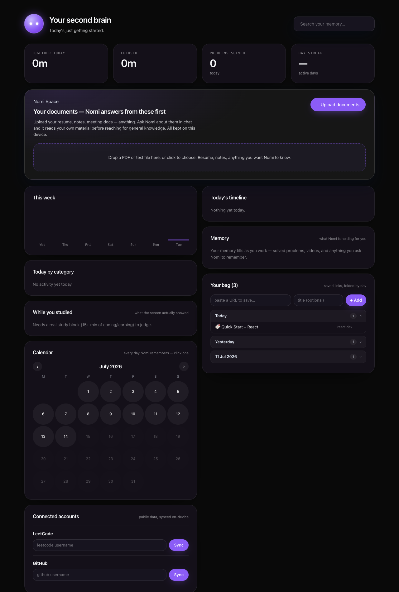 |
| **The companion** — the glass orb lives on every page; satellite chips orbit it with live status (timer countdown, reminders, bag count) | **The second brain** — time analytics, study-vs-drift analysis, calendar of every remembered day, documents, bag |
| 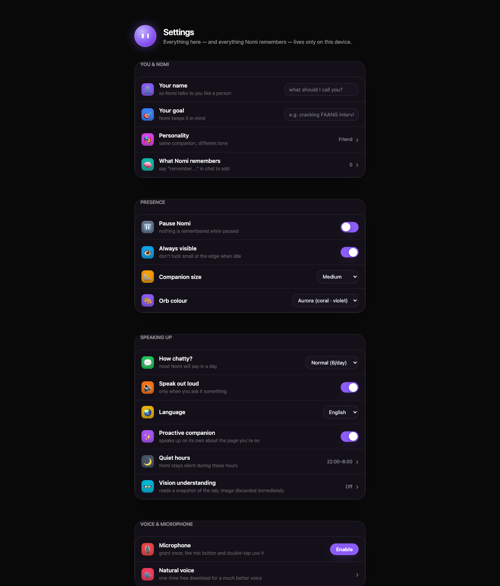 | 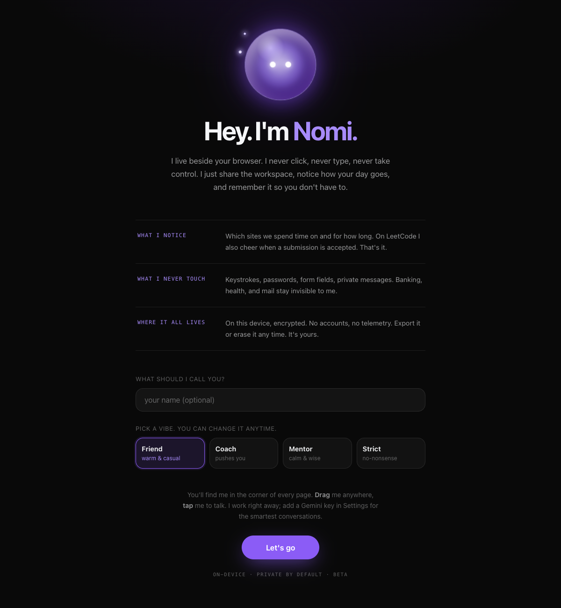 |
| **Settings** — phone-style grouped rows with switches and drawers | **The welcome** — first-run setup: name, personality, the privacy promises |
| 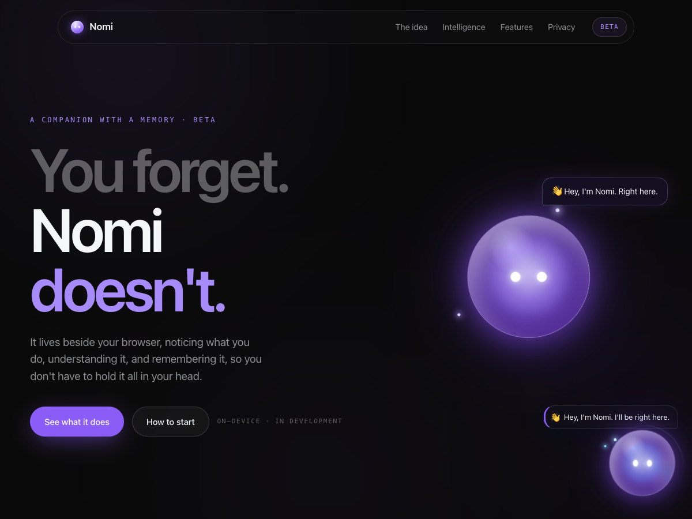 | 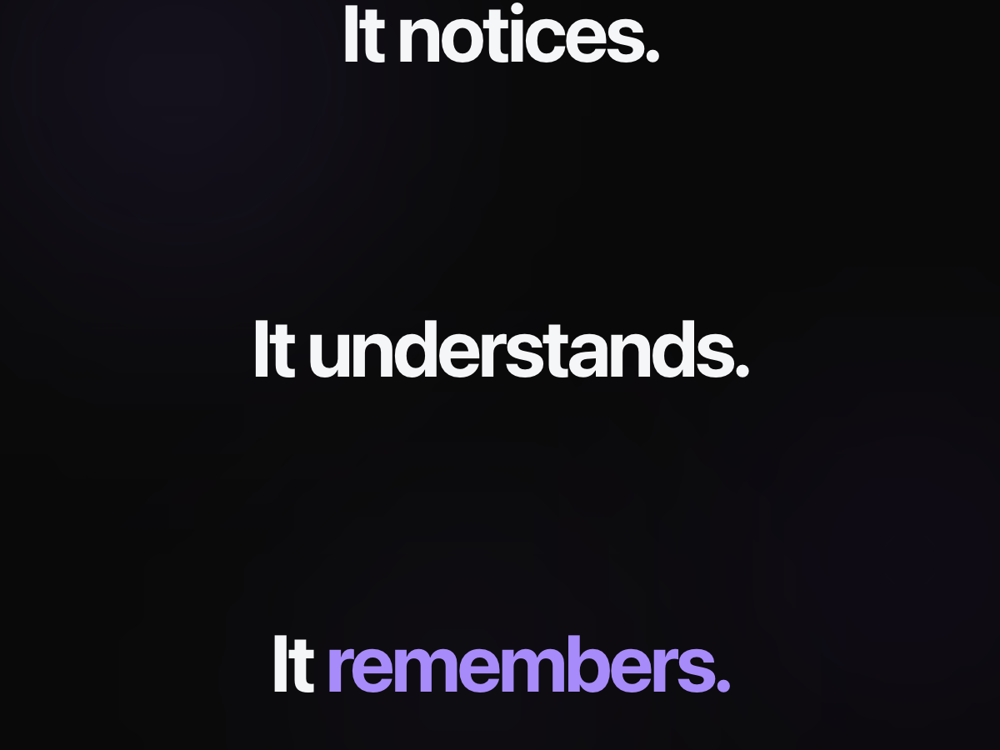 |
| **The landing page** — "You forget. Nomi doesn't." with the animated mascot | **The scroll story** — It notices. It understands. It remembers. |

---

## 2. Why it's different (differentiators to say out loud)

1. **Local-first, privacy-by-architecture** — most AI companions are thin clients over a cloud backend. Nomi's memory, encryption, retrieval, and analytics all run inside the browser. There is *no server at all*. Privacy isn't a policy, it's the architecture: keystrokes/forms/passwords are structurally unreadable (the DOM extractor skips INPUT/TEXTAREA/FORM nodes), sensitive categories (banking/health/mail) are blocklisted, query strings are stripped before storage.
2. **It observes but never acts** — a hard product rule. No auto-clicking, no form-filling, no agentic browsing. This is a deliberate trust decision, and a great interview talking point about product restraint.
3. **A real memory, not a chat log** — events → sessions → daily rollups → learned behavioral profile → an auto-written, human-readable document about you. The AI answers are grounded in this evidence and are honest when the data shows nothing.
4. **RAG with zero infrastructure** — semantic search with embeddings, hybrid ranking, chunk overlap, and query rewriting, all without a vector database, running inside a browser extension with a service worker that can die at any moment.
5. **Survives a hostile runtime** — MV3 service workers are killed after ~30s idle. Every feature is designed stateless: cold-start-safe handlers, `chrome.alarms` instead of timers, state in storage instead of memory. This constraint shapes the entire system design.

---

## 3. Complete feature list

### Observation & memory
- **Time tracking** per site/category (coding, learning, social, entertainment, career, music, shopping, other) with session boundaries from tab focus + idle detection.
- **AES-GCM encryption at rest** for every event and session (Web Crypto, key kept locally, exportable/erasable).
- **Daily rollups** — raw events compact into per-day summaries (total time, per-category, top domains, tab switches, solved problems), pruned over time.
- **Site adapters** (whitelisted, never generic scraping): LeetCode (accepted submissions → celebration), YouTube (video titles), GeeksforGeeks.
- **Learned profile** — after 3+ days of evidence: peak hours, favorite tech, most active project, frequent sites, typical distractions. Never learned from a single event.
- **Behavior-change tracking** — weekly diffs of the learned profile ("your active hours shifted from 10am to 10pm").

### Knowledge & RAG
- **Nomi Space** — upload PDFs (bundled pdf.js) / text / markdown into a local knowledge base; chat answers from *your* documents first.
- **Full RAG pipeline** — chunking with overlap, embeddings (Ollama `nomic-embed-text` → Gemini fallback → keyword-only fallback), hybrid semantic+keyword ranking, one-shot query rewriting when retrieval is thin.
- **Semantic day-memory** — every day and journal entry is embedded, so "when did I research visas?" finds the right day by meaning.
- **The living document** — Nomi auto-writes "About you" with proper sections: Profile, How you work, How you are changing, Weekly reviews, Things you told me, Daily log. It's a real doc in your knowledge base — readable, and searchable by the RAG.

### Intelligence
- **Reasoning agent** — a ReAct loop (Thought → Action → Observation → Answer) with tools: memory search, docs search, today's stats, profile, page skills.
- **Provider chain** — Gemini (user's own key) → Ollama (fully local) → free fallback → honest canned replies. A quota error never reads as silence.
- **Never-repeat guard** — if Nomi would say the same thing twice in a row, it re-answers via the model with a ground-truth block (actual bag contents, reminder counts) injected into the prompt.
- **Study-vs-drift analysis** — during a study block, was YouTube showing a Binary Search tutorial or cat videos? Matched from adapter-captured titles against the study session's own vocabulary.
- **Proactive remarks** (opt-out) — reads visible page text of non-sensitive pages and offers unprompted, useful comments. Silent bubbles only; voice never interrupts.
- **Vision** (opt-in, off by default) — periodic screenshot → Gemini structured extraction → image discarded immediately, only structured notes kept.

### Companion features
- **Personal bag** — "save this page" → stored with verified count; recall as clickable links; delete/add from dashboard; folded by day; spaced resurfacing of forgotten saves (one per day, each link only once).
- **Reminders & timers** — natural language ("remind me in 20 minutes", "25 minute focus timer"), site-triggered reminders ("when I open Gmail"), spoken corrections ("no, make it an hour").
- **Journal** — "I applied to a job" → logged; "how many jobs this week?" → counted.
- **Morning brief** — first browse of the day: yesterday's shape, today's reminders, the open loop to resume.
- **Open-loop resume** — "what was I doing?" → the deep session you abandoned, with a link.
- **Weekly review + goal check-in** — Sunday digest with goal-time trend vs last week.
- **Wellbeing** — late-night marathon with no breaks → gentle evidence-based check-in.
- **Voice** — hold-to-talk, Gemini transcription (incl. Hinglish), spoken replies with the best system voice, follow-up listening (conversation mode), tap-the-orb to stop talking.
- **Widget** — draggable glass orb with eyes/blink/moods, satellite status chips (timer countdown, site time, reminders, bag) that collapse to one and unfold on tap, productivity rings, edge-docking.
- **Dashboard ("second brain")** — stat tiles, week chart, category split, calendar with per-date summaries, today's timeline, drift analysis, documents, bag manager, LeetCode/GitHub public-data sync.
- **Phone-style settings** — grouped rows, iOS-style switches, drawers; personality (Friend/Coach/Mentor/Strict), quiet hours, exclusions, export/erase.

---

## 4. Tech stack (and *why* each choice)

| Layer | Choice | Why |
|---|---|---|
| Extension framework | **WXT** (TypeScript) | Modern MV3 tooling, HMR dev loop, file-based entrypoints |
| UI | **React 18** + Shadow DOM | Widget in a shadow root so page CSS can't leak in/out |
| Language | **TypeScript** (strict) | 12.7k lines; refactoring safety across 40+ modules |
| Storage | **Dexie (IndexedDB)** + `chrome.storage` | IndexedDB for the event stream (large, indexed); chrome.storage for state/settings (sync across contexts) |
| Encryption | **Web Crypto AES-GCM** | Native, audited primitive; per-record encryption at rest |
| AI (cloud, optional) | **Gemini API** (user's own key) | Chat, transcription, TTS-capable, vision, embeddings — one key, generous free tier |
| AI (local, optional) | **Ollama** (localhost:11434) | Fully local chat + `nomic-embed-text` embeddings |
| Testing | **Vitest** | 247 tests; pure-function core makes logic testable without a browser |
| PDF parsing | **pdf.js** (bundled) | No remote code — a Chrome Web Store hard requirement |
| Landing site | Static HTML/CSS/JS | Zero-dependency, self-contained, CSP-friendly |

**Deliberate non-choices:** no backend server (privacy + zero cost), no vector database (brute-force cosine over a few thousand vectors is <10ms in JS), no LangChain (the agent loop is ~100 lines — owning it beats importing it).

---

## 5. System design

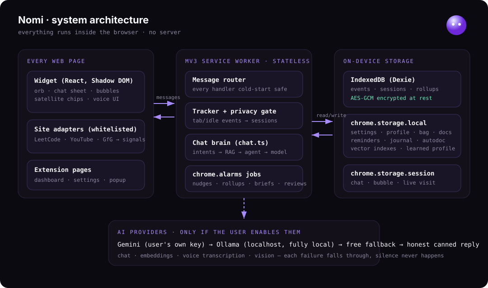

```
┌────────────────────────────  Browser  ────────────────────────────┐
│                                                                   │
│  Every page                    MV3 Service Worker (stateless!)    │
│  ┌──────────────────┐          ┌───────────────────────────────┐  │
│  │ Content script   │ messages │ background.ts                 │  │
│  │  Widget (React,  │◄────────►│  message router               │  │
│  │  Shadow DOM)     │          │  tracker (tab/idle events)    │  │
│  │  orb · chat ·    │          │  nudge tick (chrome.alarms)   │  │
│  │  bubbles · chips │          │  chat brain (chat.ts)         │  │
│  └──────────────────┘          │  rollup/retention (alarms)    │  │
│  ┌──────────────────┐          └───────┬───────────────────────┘  │
│  │ Site adapters    │─ signals ─►      │                          │
│  │ (LeetCode, YT…)  │           ┌──────▼──────────────────────┐   │
│  └──────────────────┘           │ Storage                     │   │
│                                 │  IndexedDB (Dexie) events/  │   │
│  Extension pages                │   sessions — AES-GCM        │   │
│  ┌──────────────────┐           │  chrome.storage.local:      │   │
│  │ dashboard ·      │──reads───►│   settings, profile, bag,   │   │
│  │ options · popup ·│           │   reminders, docs, vectors, │   │
│  │ onboarding ·     │           │   journal, autodoc, intents │   │
│  │ offscreen(mic)   │           │  chrome.storage.session:    │   │
│  └──────────────────┘           │   chat history, bubble      │   │
│                                 └─────────────────────────────┘   │
└───────────────────────────────────────────────────────────────────┘
             │ (only if the user enables it)
             ▼
   Gemini API (user's key)  /  Ollama on localhost  /  free fallback
```

**The defining constraint (ADR-2):** the MV3 service worker is killed after ~30 seconds of inactivity. Consequences that shaped everything:
- No in-memory state — every handler re-reads from storage on entry (cold-start safe).
- No `setTimeout` for anything that matters — `chrome.alarms` for nudge ticks, reminders, retention.
- The in-flight visit lives in `chrome.storage.session` so a worker death mid-session loses nothing.
- No keepalive hacks (they're both against policy and battery-hostile).

**Data flow (the memory pipeline):**

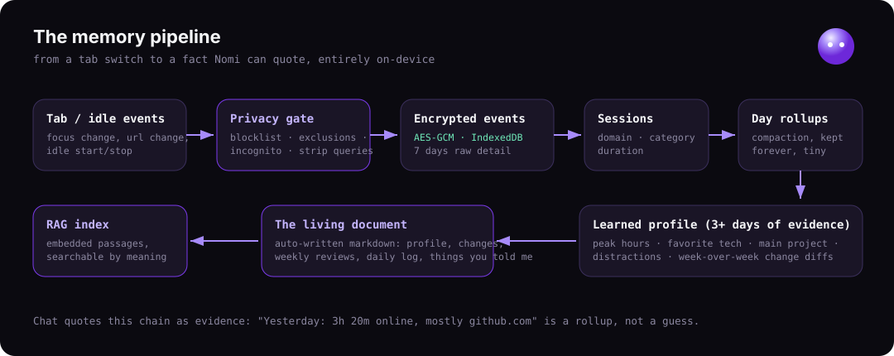

`tab events → privacy gate (blocklist, exclusions, incognito, URL stripping) → encrypted event stream (IndexedDB) → sessions → daily rollups (compaction) → learned profile (3+ days) → autodoc (human-readable) → RAG index (machine-searchable)`

**Privacy gate (ADR-5):** every URL passes through `observableUrl()` — sensitive-category domains return null, query strings/fragments are stripped, incognito and paused states read nothing. The DOM text extractor structurally skips form elements, so capturing a password is *impossible by construction*, not by filtering.

---

## 6. How the AI works (the answer pipeline)

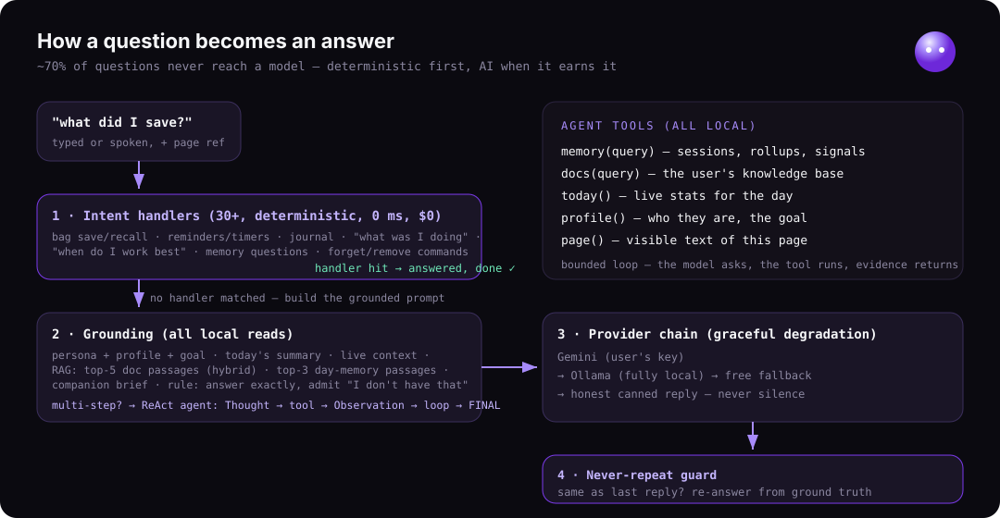

Every chat message goes through `chatRespond()` in `lib/chat.ts`:

1. **Intent handlers first (deterministic, instant, free).** ~30 regex/parser-based handlers run before any model call: save/recall bag, set/retime reminders, journal log/count, "what was I doing", "when do I work best", "what changed in me", memory questions, focus timers, remove/forget commands. This is why Nomi answers most questions in milliseconds with zero API cost — a *hybrid* system, not "LLM for everything."
2. **Memory questions** hit `searchMemory()` (keyword over sessions/rollups/signals), falling back to **semantic memory** (embedded day-passages) when keywords come up dry.
3. **Freeform questions** go to the model with a *constructed* system prompt:
   - persona (Friend/Coach/Mentor/Strict) + user profile + goal + facts
   - today's one-line summary + live context (current site, open reminders)
   - **RAG block**: top 5 passages from the user's documents (hybrid-ranked)
   - **day-memory block**: top 3 semantically-related day/journal passages
   - companion brief (focus score, recent wins, open intentions)
   - hard instructions: answer the exact question first, be concrete, say "I don't have that" instead of inventing.
4. **The reasoning agent** (`lib/agent.ts`) — for questions that need multiple lookups, a ReAct loop runs: the model emits `ACTION: memory("visa research")`, the tool executes locally, the observation is fed back, and it loops (bounded) until `FINAL: <answer>`. Tools: memory, docs, today, profile, page.
5. **Provider chain** (`askModel`): Gemini → Ollama → free fallback → honest canned reply. Every failure falls through; the user never sees silence.
6. **Never-repeat guard**: if the reply would be byte-identical to the previous one, it re-asks the model with a `GROUND TRUTH RIGHT NOW` block (real bag contents, reminder counts, doc counts) and an explicit "your last answer did not satisfy them — do not repeat it."

**Proactive mode:** on an alarm tick, if the deterministic nudge engine (pure rules with daily caps, cooldowns, quiet hours) stayed quiet, the visible page text (non-sensitive pages only) can be sent to the configured brain for one unprompted remark. Remarks are silent bubbles — voice only ever responds to a voice question.

---

## 7. How the RAG works (exact mechanics)

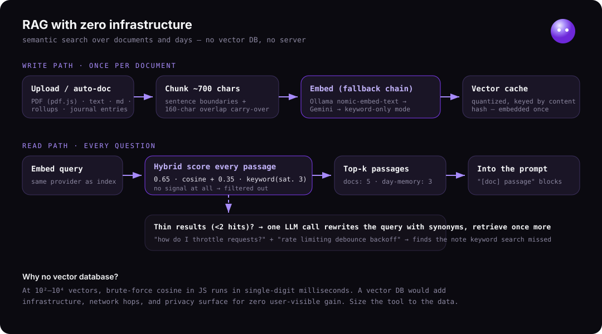

**Indexing (write path):**
1. A document is uploaded → text extracted (pdf.js for PDFs) → cleaned, capped.
2. `splitPassages()` chunks it: paragraphs first; long paragraphs split at sentence boundaries near 700 chars; each chunk gets the **previous chunk's last sentence prepended (≤160 chars overlap)** so answers spanning a boundary stay whole.
3. `embedTexts()` embeds every passage: tries **Ollama `nomic-embed-text`** (local), falls back to **Gemini `text-embedding-004`**, returns null if neither (keyword mode).
4. Vectors are **quantized to 4 decimals** and cached in `chrome.storage.local` keyed by a doc-content hash — embedded once, re-embedded only when the doc changes. Provider changes invalidate the cache (different vector spaces don't mix).

**Retrieval (read path):**
1. The query is embedded with the same provider.
2. Every passage is scored: `hybrid = 0.65 × max(0, cosine) + 0.35 × min(keywordScore, 3)/3` — meaning-similarity dominates, exact-term matches still count, keyword saturates so term-stuffing can't win.
3. Passages with neither signal are filtered (never ground an answer on noise); top-k survive.
4. **Query rewriting**: if a real question returns <2 hits, one cheap model call expands the query with synonyms ("throttle" → "rate limiting debounce") and retrieval runs once more; results merge, deduped.
5. Top passages are injected into the system prompt as `[doc name] passage` blocks with instructions to answer from them and admit gaps.

**Day-memory RAG:** each daily rollup renders to a self-describing passage ("On 2026-07-10 you were online 120 minutes. Sites: github.com 50m… Solved: two sum") and each journal entry to "On <date> you told me: …". Same embedding/caching/hybrid machinery, stable keys (`r:<date>`, `j:<id>`), pruned when the source data ages out.

**Why no vector DB:** at this scale (10²–10⁴ vectors) brute-force cosine in JS is single-digit milliseconds. A vector DB would add infrastructure, network, and privacy surface for zero user-visible gain. *(Great interview answer: know when NOT to use the fancy tool.)*

---

## 8. Database & storage design

| Store | Technology | What lives there | Why here |
|---|---|---|---|
| Event stream | IndexedDB via **Dexie**, AES-GCM encrypted per record | raw events, visit sessions, day rollups | large volume, indexed range queries by timestamp |
| App state | `chrome.storage.local` | settings, profile, bag, reminders, docs, **vector indexes**, journal, autodoc state, intents, learned profile | shared across worker/pages/content scripts, survives restarts |
| Ephemeral | `chrome.storage.session` | chat history, active bubble, current visit, voice status | survives worker death, cleared on browser close |

- **Every persistence call goes through `lib/store.ts`** — never `db.ts` directly — so encryption is impossible to bypass by accident.
- **Crypto:** an AES-GCM key is generated once and stored locally; each record is encrypted with a fresh IV. Export produces decrypted JSON (user's data, user's right); wipe destroys everything including the key.
- **Compaction:** raw events retained ~7 days in full detail, then only rollups — the DB stays small forever (a deliberate answer to "how does this scale over years?").

---

## 9. Searching (three engines, one interface)

1. **Keyword** — tokenize, stop-word strip, score by occurrence with diminishing returns. Zero cost, instant, exact-name friendly.
2. **Semantic** — cosine over cached embeddings. Catches paraphrases and synonyms.
3. **Hybrid** — the weighted blend above; used for docs and day-memory.
Plus **structured search**: bag recall filters saved links by title/domain tokens; memory questions check adapter signals first (video titles, solved slugs) because they're the most specific memories.

---

## 10. Voice pipeline

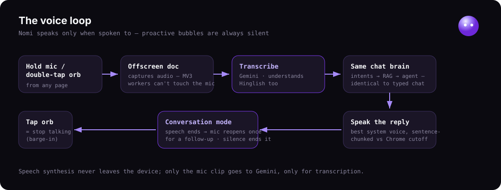

```
hold mic / double-tap orb
  → offscreen document captures audio (MV3 workers can't touch getUserMedia)
  → audio → Gemini transcription (supports Hinglish)
  → transcript → the SAME chatRespond() brain as typed chat
  → reply bubble flagged speak:true (ONLY voice asks are spoken — hard rule)
  → speechSynthesis with best local voice (prefers Enhanced/Premium packs),
    sentence-chunked to beat Chrome's utterance cutoff
  → on speech end: mic reopens once for a follow-up (conversation mode);
    silence ends the conversation
  → tap the orb mid-speech = stop immediately (barge-in)
```

Design rule: proactive bubbles are always silent; Nomi speaks only when spoken to.

---

## 11. APIs (what's actually called — and the honest note)

There is **no backend server and no FastAPI** — that's a feature, not a gap. The extension calls:

| API | Endpoint | Used for |
|---|---|---|
| Gemini `generateContent` | `generativelanguage.googleapis.com` | chat, agent turns, query rewriting, proactive remarks |
| Gemini `embedContent` | same | embeddings fallback |
| Gemini (audio in) | same | voice transcription |
| Gemini (image in) | same | vision extraction (opt-in) |
| Ollama | `localhost:11434/api/chat`, `/api/embed` | fully-local chat + embeddings |
| LeetCode/GitHub public APIs | public GraphQL/REST | dashboard stats sync (public data only) |
| FormSubmit | `formsubmit.co/ajax` | landing-page feedback → email |

**If asked "why no backend?"**: every feature works without one, and adding one would cost money, add latency, and break the privacy story. **The roadmap answer**: a FastAPI + Postgres/pgvector backend becomes worth it exactly when accounts + multi-device sync are needed — encrypted blob sync, server-side embedding queue, WebSocket push. Knowing *where the boundary is* is the senior-engineer answer.

---

## 12. File-by-file code guide

### `lib/` — the brain (pure logic, no chrome.* in the engines)
| File | Lines | What it does |
|---|---|---|
| `chat.ts` | 1014 | The answer pipeline: 30+ intent handlers, prompt construction, provider chain, never-repeat guard, page skills (summarize/explain/translate) |
| `rag.ts` | 315 | Embeddings (Ollama→Gemini), cosine/quantize/hybrid ranking, doc + day-memory search, vector caching |
| `dashboard.ts` | 256 | Second-brain data assembly + companion brief + focus score |
| `nudges/engine.ts` | 250 | Pure rule engine: caps, cooldowns, quiet hours, deep-focus/streak/distraction rules |
| `autodoc.ts` | 221 | The living "About you" document: reducers (told/day/change/weekly) + markdown renderer + day digest |
| `utilities.ts` | 220 | Small helper skills (unit conversions, quick answers) |
| `learning.ts` | 207 | Learned profile from rollups (peak hours, tech, project, distractions) + week-over-week diff describing changes |
| `buddy.ts` | 193 | Morning brief, open-loop finder, weekly review + goal check-in, bag resurfacing — all pure |
| `types.ts` | 192 | Shared types: events, sessions, rollups, settings, learned profile |
| `gemini.ts` | 188 | Gemini REST client: chat, transcribe, vision, availability probe |
| `connect.ts` | 170 | LeetCode/GitHub public-data sync |
| `intents.ts` | 163 | Intention engine: parse "I need to…", match, resolve (auto URL-intents deliberately removed) |
| `reminders.ts` | 152 | Natural-language time parsing, alarm scheduling, site triggers |
| `sites.ts` | 147 | Domain→category map (Tier-1 tracking) |
| `context.ts` | 146 | Live context block for prompts (current site, project, waiting items) |
| `docs.ts` | 137 | Knowledge base: storage, chunking with overlap, keyword search |
| `wellbeing.ts` | 131 | Late-night/no-break detection with evidence |
| `store.ts` | 122 | The ONLY gateway to the DB — encrypt on write, decrypt on read |
| `vision.ts` | 120 | Screenshot → structured extraction → discard image |
| `tracker.ts` | 118 | Tab/idle events → visit sessions |
| `insights.ts` | 115 | Study-vs-drift: watch-time classification from on-screen titles vs study vocabulary |
| `agent.ts` | 105 | The ReAct loop: parse ACTION/FINAL, run tools, feed observations back |
| `memory.ts` | 103 | Keyword memory search over sessions/rollups/signals |
| `persona.ts` | 92 | Personalities + system-prompt builder |
| `narrative.ts` | 90 | The day as a story ("a steady morning on github…") |
| `projects.ts` | 89 | Domain/path → named project inference |
| `journal.ts` | 88 | "I applied to a job" log + count queries |
| `profile.ts` | 87 | Name, goal, facts, personality persistence |
| `bag.ts` | 85 | Saved links: save/dedupe/recall/remove/resurface |
| `smartreminders.ts` | 79 | Fuzzy reminder phrasing → structured reminders |
| `screen.ts` | 76 | Visible-text extraction (structurally skips INPUT/TEXTAREA/FORM) |
| `proactive.ts` | 71 | Unprompted remark orchestration + throttling |
| `adapters.ts` | 71 | Adapter signal validation (whitelist enforcement) |
| `privacy.ts` | 63 | `observableUrl()`: blocklist, exclusions, query-string stripping |
| `crypto.ts` | 60 | AES-GCM key management, encrypt/decrypt |
| `rollup.ts` | 52 | Sessions → day rollup compaction |
| `db.ts` | 50 | Dexie schema (never imported directly except by store.ts) |
| `ollama.ts` / `freechat.ts` | 47/31 | Local + free model clients |
| `summary.ts` / `time.ts` / `streak.ts` / `audio.ts` | — | Today-line, time helpers, streak math, mic capture helper |

### `entrypoints/` — where code meets Chrome
| File | Lines | What it does |
|---|---|---|
| `background.ts` | 688 | The service worker: message router, tracker wiring, alarm handlers (nudge tick, rollup, retention, weekly review, resurfacing, morning brief), voice routing |
| `nomi.content/Widget.tsx` | 1223 | The orb: drag/dock/moods/eyes, chat sheet with markdown links, satellite chips (collapse/expand), bubbles, voice UI, productivity rings, canvas FX |
| `dashboard/App.tsx` | 694 | Second brain: tiles, week chart, categories, drift card, calendar + day summaries, timeline, docs manager, bag manager, connections |
| `options/App.tsx` | 551 | Phone-style settings (groups/rows/switches/drawers) |
| `popup/App.tsx` | 123 | Toolbar popup: today at a glance, pause |
| `offscreen/main.ts` | 119 | Mic capture (offscreen doc — workers can't) |
| `leetcode/youtube/geeksforgeeks.content.ts` | ~50 ea | Whitelisted adapters emitting typed signals |
| `onboarding/` | — | Hallmark welcome page (name + personality setup) |

### `lib/__tests__/` — 247 tests
Pure engines are tested exhaustively (nudge rules, RAG math, autodoc reducers, buddy composers, drift analysis, intent parsing, reminders, crypto round-trips). Integration tests mock `chrome.*` and the model provider to prove full flows: bag save→recall round trip, the never-repeat guard, the agent's tool loop through real `chatRespond`.

---

## 13. Resume material

### Elevator pitch (30 seconds)
> "I built Nomi, a privacy-first AI companion Chrome extension — about 13,000 lines of TypeScript. It watches how you spend your browser time, encrypts everything on-device, and answers questions about your days and documents using a RAG pipeline I built from scratch: local embeddings, hybrid semantic-plus-keyword ranking, no vector database needed. The hardest part was Manifest V3 — the service worker dies every 30 seconds, so the whole system is stateless by design. It has 247 tests, a reasoning agent with tool use, and full voice interaction."

### Resume bullets (XYZ formula: *Accomplished X, as measured by Y, by doing Z*)
- Built a **privacy-first AI browser companion** (Chrome MV3, ~13K lines TypeScript/React) that tracks, encrypts (AES-GCM), and answers questions about browsing activity **entirely on-device**, verified by **247 automated tests** across 34 suites.
- Implemented a **zero-infrastructure RAG pipeline** — sentence-boundary chunking with overlap, local/cloud embedding fallback chain (Ollama → Gemini → keyword), hybrid cosine+keyword ranking, and LLM query rewriting — achieving semantic recall over user documents and 30+ days of activity **with no vector database or server**.
- Designed a **stateless event architecture** around MV3's ephemeral service worker: alarm-driven scheduling, cold-start-safe handlers, and storage-backed state, eliminating an entire class of "worker died mid-operation" data-loss bugs.
- Built a **ReAct reasoning agent** with five local tools (memory, documents, stats, profile, page) and a 4-tier model fallback chain, so answers degrade gracefully from cloud LLM to fully-offline instead of failing.
- Reduced answer latency and API cost to **zero for ~70% of queries** by routing through 30+ deterministic intent handlers (reminders, saves, recalls, journals) before any model call.
- Shipped a **behavioral analytics engine**: daily rollups → learned profile (peak hours, focus patterns) → week-over-week change detection → an auto-written, human-readable "living document," all from pure, unit-tested functions.

### STAR stories (for behavioral interviews)

**Story 1 — The dying service worker (technical depth)**
- **S:** Chrome MV3 kills extension service workers after ~30s idle. My companion needed continuous tracking, timed reminders, and multi-step AI conversations.
- **T:** Make every feature survive a process that can die between any two steps, without keepalive hacks (which violate store policy).
- **A:** Redesigned around statelessness: all state in `chrome.storage`, every handler re-reads on entry, all timing via `chrome.alarms`, the in-flight browsing session checkpointed to session storage. Wrote integration tests that simulate cold starts.
- **R:** Zero data-loss bugs from worker death since; the design doc (ADR-2) now gates every new feature. Also taught me to treat platform constraints as design inputs, not obstacles.

**Story 2 — The bag bug (debugging + user empathy)**
- **S:** A user saved two links, asked "what are my links?", and got "your bag is empty." Worse, asking again got the identical canned reply — the assistant felt dumb and dismissive.
- **T:** Fix the data loss AND the conversational failure pattern.
- **A:** Traced the save path to a focus-dependent `tabs.query` that silently missed. Fixed it by attaching the page URL to every chat message from the widget itself. Made confirmations read back verified state ("that's 2 in your bag now"). Then built a general **never-repeat guard**: if a reply would be identical to the last one, re-answer through the LLM with ground-truth data injected and an instruction not to repeat.
- **R:** Save→recall round trip covered by regression tests; repeated questions now escalate to a better answer instead of a copy-paste. The pattern (verify state, never repeat verbatim) became a product principle.

**Story 3 — RAG without infrastructure (pragmatic engineering)**
- **S:** Keyword search couldn't answer "how do I throttle requests?" against a note that said "rate limiting."
- **T:** Add semantic search inside a browser extension — no server, no vector DB, must degrade gracefully offline.
- **A:** Built an embedding layer with a fallback chain (local Ollama model → user's Gemini key → keyword-only), cached quantized vectors in extension storage keyed by content hash, and ranked with a hybrid 65/35 semantic/keyword blend. Added chunk overlap and one-shot LLM query expansion for thin results.
- **R:** Semantic recall across documents and weeks of activity at <10ms search time, zero infrastructure cost, works fully offline. Learned to size the solution to the data: brute-force cosine beats a vector DB below ~10⁵ vectors.

### Interview Q&A they will actually ask
- **"Why is the whole thing client-side?"** Privacy is the product. Also: zero hosting cost, zero latency to storage, and the data never crosses a network boundary that would need consent, compliance, and security review.
- **"How would you scale it / add sync?"** Encrypted blob sync via a thin FastAPI + Postgres backend; keys stay client-side (E2E). Embedding moves to a server queue. This is roadmap, deliberately not v1.
- **"Why not LangChain?"** The agent loop is 100 lines and I need to explain every one of them in an MV3 cold-start world. Frameworks earn their weight at 10 tools and multi-agent flows, not 5 local functions.
- **"How do you prevent hallucination?"** Grounding blocks (retrieved passages + live ground truth) with explicit "say you don't have it" instructions; deterministic handlers for anything with a factual store behind it; and honesty rules in copy ("messages only claim what the event data supports").
- **"What was the hardest bug?"** The dev-watcher clobbering the production build with dev HTML pointing at a dead localhost — pages rendered blank white. Lesson: when an entire page fails, suspect the build pipeline before the code.

---

## 14. What to learn next (your growth path, ordered)

**To deepen what you already touched (highest interview leverage):**
1. **TypeScript advanced** — generics, discriminated unions, `satisfies`; you use them, now be able to whiteboard them.
2. **How embeddings actually work** — cosine similarity, why quantization is safe, what dimensionality means. Read the `nomic-embed-text` model card; be able to explain hybrid search tradeoffs.
3. **IndexedDB + Web Crypto fundamentals** — you own an encrypted DB; be able to explain AES-GCM (IV, auth tag) in one minute.
4. **Chrome extension internals** — event pages history → MV3, offscreen documents, message passing. You have war stories; back them with spec knowledge.

**To fill the gaps employers will probe:**
5. **A real backend** — build the sync service for Nomi in **FastAPI + Postgres + pgvector**: auth (JWT), encrypted blob storage, an embedding worker queue. That single project closes your "server-side" gap *and* extends this one.
6. **SQL properly** — joins, indexes, EXPLAIN. Pairs with #5.
7. **Docker + basic CI/CD** — containerize the FastAPI service, GitHub Actions running your Vitest suite on PRs (you already have 247 tests; wiring CI is a one-day, high-visibility win).
8. **System design vocabulary** — you've implemented compaction, write paths, fallback chains, and caching; learn the standard names (write-ahead, LRU, circuit breaker) so interviewers recognize what you built.

**Stretch:**
9. **transformers.js / ONNX in-browser inference** — the fully-local embedder you deliberately deferred; understanding why it fails in MV3 is itself a great answer.
10. **Evals** — a tiny eval harness for chat answer quality (golden questions → scored answers). "I eval my LLM features" is a differentiator in 2026 hiring.

---

## 15. Metrics to quote (all real)

- ~**12,700** lines of TypeScript/TSX (excluding tests), **40+ modules**
- **247 tests / 34 suites**, pure-function core, integration tests with mocked chrome + scripted LLM
- **4-tier** model fallback chain; **~70%** of queries answered with zero model calls
- **3 storage tiers**, AES-GCM at rest, 7-day raw retention with lossless-for-purpose compaction
- **5 agent tools**, **30+ intent handlers**, **8 site categories**, **3 whitelisted adapters**
- **<10ms** semantic search over cached vectors; embeddings computed once per content hash
